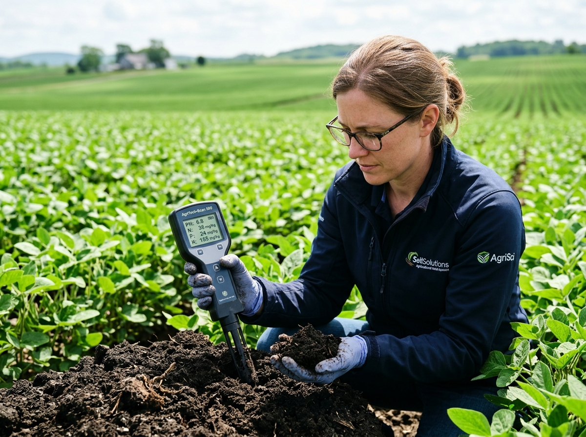
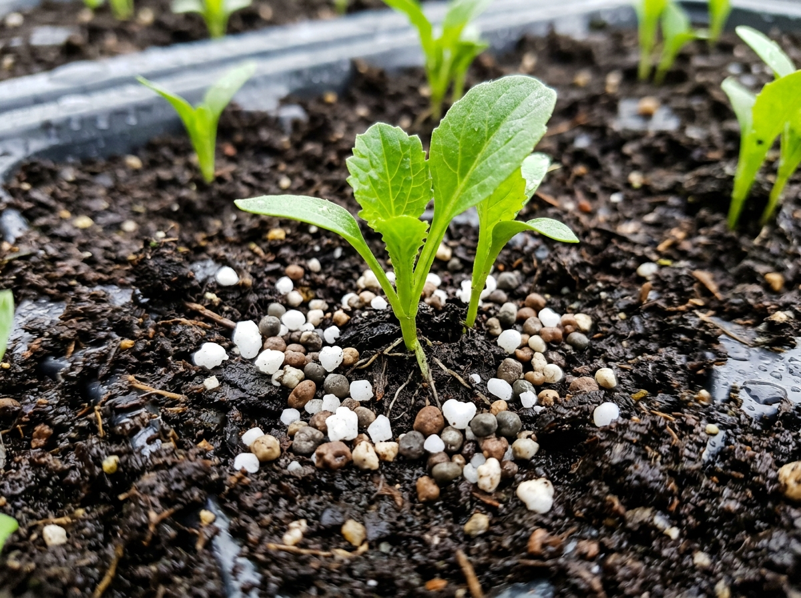
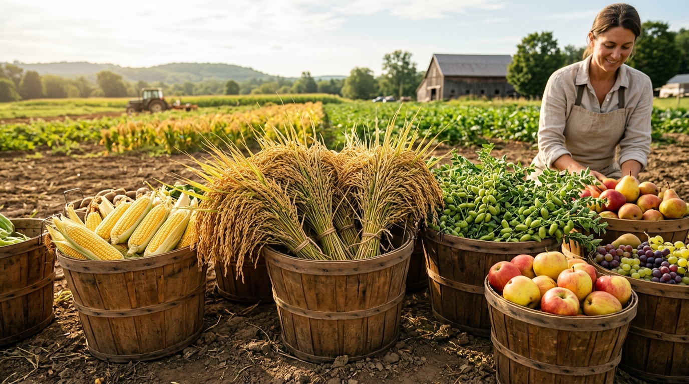

# 🌾 Smart Crop and Fertilizer Advisor — AI Expert System

An AI Expert System combining **Machine Learning crop classification** with a **rule-based agronomic inference engine**, **temporal crop rotation scheduler**, and an **interactive explanation facility**. Styled with the professional **AgriCulture Bootstrap 5** theme.

---

## 📸 System Previews & Relevant Imagery

| Precision Soil Health Analysis | Targeted Fertilizer Application | Bountiful Harvest Maximization |
| :---: | :---: | :---: |
|  |  |  |

---

## 🎯 4 Core Agronomic Pillars for Crop Recommendation

Our expert system evaluates 4 essential field and temporal parameters to determine the ideal crop:

1. **Soil Condition & Classification**:
   * Evaluates soil texture and structure: **Loamy** (balanced), **Clayey** (heavy water retention), **Sandy** (high aeration & drainage), **Black Cotton Soil** (montmorillonite clay), **Alluvial** (delta silt), and **Red Soil** (porous iron-rich).
   * Verifies soil chemical reaction (**pH**) against the crop's physiological tolerance.
2. **Time of Year / Sowing Season**:
   * Aligns sowing with optimal photoperiods and seasonal rainfall patterns:
     * **Kharif (Monsoon: June – October)**: Rice, Maize, Cotton, Jute, Pigeonpeas, Blackgram.
     * **Rabi (Winter: October – March)**: Chickpea, Lentil, Kidney Beans, Maize.
     * **Zaid (Summer: March – June)**: Mung Bean, Muskmelon, Watermelon, Moth Beans.
     * **All Year / Perennial**: Banana, Papaya, Grapes, Apple, Orange, Coconut, Coffee.
3. **Ambient Temperature**:
   * Ensures seasonal heat accumulation (Growing Degree Days - GDD) falls within the crop's vegetative and flowering thresholds ($T_{\text{min}} \le T \le T_{\text{max}}$).
4. **Time Between Two Crop Harvesting (Fallow Gap Window in Days)**:
   * Guarantees the recommended crop completes its life cycle within the days available before the farmer's next primary crop planting:
     * **Short Catch Crops (60 – 75 days)**: Mung Bean (60–75d), Moth Beans (65–80d), Muskmelon (70–85d), Watermelon (75–90d).
     * **Medium-Cycle Crops (90 – 120 days)**: Chickpea (90–120d), Maize (80–110d), Lentil (100–130d), Blackgram (70–90d).
     * **Full-Season Crops (120 – 180+ days)**: Rice (110–150d), Jute (120–150d), Cotton (150–180d), Pigeonpeas (150–200d).
     * **Perennial Orchards (300+ days / No gap limit)**: Fruit orchards and plantation crops.

---

## 🔄 Crop Rotation & Symbiotic Soil Regeneration

When farmers grow nitrogen-depleting cereal crops (*Rice, Wheat, Maize, Cotton*), planting a subsequent leguminous catch crop (*Mungbean, Chickpea, Blackgram, Lentil*) naturally fixes **30 – 50 kg/ha atmospheric Nitrogen** into the rhizosphere via *Rhizobium* root nodules:

* **Breaks host-specific pest and weed cycles.**
* **Restores organic humus and subsoil porosity.**
* **Reduces chemical fertilizer costs for the subsequent crop by 25–40%.**

---

## 🧮 Fertilizer Dosage Rule Formulation

$$\text{Dosage (kg/hectare)} = \frac{\text{Nutrient Deficit Gap (kg/ha)}}{\frac{\text{Active Nutrient Percentage}}{100}}$$

*Example:*
- **Crop:** Rice (Ideal Nitrogen = 80 kg/ha)
- **Soil Test:** Nitrogen = 60 kg/ha
- **Deficit Gap:** $80 - 60 = 20\text{ kg/ha}$
- **Fertilizer:** Urea (46% Nitrogen)
- **Calculated Dosage:** $\frac{20}{0.46} = 43.48\text{ kg/ha}$ ($\approx 17.6\text{ kg/acre}$)

---

## 📁 Project Directory Structure

```text
AgriTech/
├── app.py                            # Main Flask Web Server & WSGI Entrypoint
├── vercel.json                       # Vercel Serverless Deployment Config
├── requirements.txt                  # Production Python Dependencies
├── .gitignore                        # Git Ignore Rules
├── test_expert_system.py              # Automated Unit Test Suite (7/7 tests passing)
├── README.md                         # Project Documentation
│
├── crop_expert_system/               # Core AI Expert System Python Package
│   ├── __init__.py
│   ├── knowledge_base.py             # 22 Crop Profiles & 22 Production Rules
│   ├── predictor.py                  # ML Inference & SoilInput Validation
│   ├── inference_engine.py           # Forward-Chaining Engine & Temporal Scheduler
│   ├── database.py                   # SQLite Audit History (Serverless & Local)
│   ├── train_model.py                # ML Trainer (RF, Decision Tree, Naive Bayes)
│   ├── app.py                        # Desktop Tkinter GUI Form
│   ├── data/
│   │   ├── crop.csv                  # 2,200 row benchmark dataset
│   │   ├── fertilizer.csv            # Active fertilizer concentrations
│   │   ├── expert_system_history.db  # SQLite database storing past consultations
│   │   └── generate_datasets.py      # Dataset generator script
│   └── models/
│       └── crop_model.pkl            # Trained model pickle
│
├── static/assets/                    # Web Assets
│   ├── css/
│   │   └── main.css                  # Responsive AgriCulture CSS with Mobile Port
│   ├── js/
│   │   └── main.js                   # Mobile Drawer & Responsive UI Logic
│   └── img/                          # High-resolution smart agriculture photography
│
└── templates/                        # Jinja2 HTML Templates (Fully Mobile-Responsive)
    ├── index.html                    # Main Home Advisor with Live Sliders & Charts
    ├── rotation.html                 # Crop Recommendation by Soil, Time, Temp & Harvest Gap
    ├── knowledge.html                # Searchable Knowledge Base Browser (22 crops & 22 rules)
    ├── history.html                  # SQLite Consultation Audit Trail & CSV Export
    └── report.html                   # Official Printable Farm Advisory Report
```

---

## 📱 How to Open on Mobile Browser

### Option 1: Local Wi-Fi Mobile Access (Instant)
When running `python app.py` on your computer, your terminal shows:
```text
 * Local PC Browser:   http://127.0.0.1:5000
 * Mobile Phone Link:  http://<Your-LAN-IP>:5000  (e.g., http://10.162.44.203:5000)
```
1. Ensure your smartphone is connected to the **same Wi-Fi network / hotspot** as your computer.
2. Open Chrome, Safari, or Brave on your phone and type:
   👉 **`http://<Your-LAN-IP>:5000`** *(e.g. `http://10.162.44.203:5000`)*
3. The interface features a dedicated mobile hamburger drawer, touch-friendly parameter sliders, and responsive report cards.

### Option 2: Public Cloud URL via Vercel (Anywhere in the World)
Once deployed on Vercel, you get an **HTTPS public URL** (e.g., `https://agritech-expert.vercel.app`) that anyone can open from any mobile phone on mobile data (4G/5G) or any Wi-Fi without configuring local IPs!

---

## 🐙 Step-by-Step GitHub Upload Guide

1. **Initialize Git in the project root** (if not already done):
   ```bash
   git init
   git add .
   git commit -m "Initial commit: AgriCulture AI Expert System ready for Vercel"
   ```

2. **Create a new repository on GitHub**:
   - Go to [github.com/new](https://github.com/new).
   - Name your repository (e.g. `agritech-expert-system`).
   - Leave "Add a README" **unchecked** (we already have a complete README).
   - Click **Create repository**.

3. **Link and Push to GitHub**:
   ```bash
   git branch -M main
   git remote add origin https://github.com/<YOUR-GITHUB-USERNAME>/<YOUR-REPO-NAME>.git
   git push -u origin main
   ```

---

## ▲ Deploying to Vercel (1-Click Deployment)

The project includes `vercel.json` and `requirements.txt` pre-configured for `@vercel/python` serverless deployment.

### Method A: Via Vercel Web Dashboard (Recommended)
1. Go to [vercel.com](https://vercel.com) and log in with your GitHub account.
2. Click **"Add New..."** → **"Project"**.
3. Select your GitHub repository (`agritech-expert-system`) and click **"Import"**.
4. Keep the default settings:
   - **Framework Preset**: *Other*
   - **Root Directory**: `./`
5. Click **"Deploy"**.
6. In ~60 seconds, Vercel will build and assign you a live production URL:
   🎉 **`https://<your-project>.vercel.app`**

### Method B: Via Vercel CLI
```bash
npm install -g vercel
vercel login
vercel --prod
```

---

---

## 🚀 How to Run the Application

### 1. Launch the Web Application (Recommended)
```bash
python app.py
```
Open your web browser and navigate to:
👉 **`http://127.0.0.1:5000`**

* **Home & Soil Advisor**: [`http://127.0.0.1:5000/`](http://127.0.0.1:5000/)
* **Seasonal & Crop Rotation (by Soil, Time, Temp & Harvest Gap)**: [`http://127.0.0.1:5000/rotation`](http://127.0.0.1:5000/rotation)
* **Knowledge Base Explorer**: [`http://127.0.0.1:5000/knowledge`](http://127.0.0.1:5000/knowledge)
* **Consultation Audit Records**: [`http://127.0.0.1:5000/history`](http://127.0.0.1:5000/history)

### 2. Launch the Desktop GUI Form (Offline Mode)
```bash
python crop_expert_system/app.py --gui
```

### 3. Run the Automated Test Suite
```bash
python test_expert_system.py
```
*(All 7 unit tests verify crop rotation logic, harvest gap fit, ML inference, rule firing, and web endpoints.)*

---

## 👥 Project Information
* **Harsh Kumawat**
* **Harshul Bhanwar**
* **Hariom Patidar**
* **Medi-Caps University**

